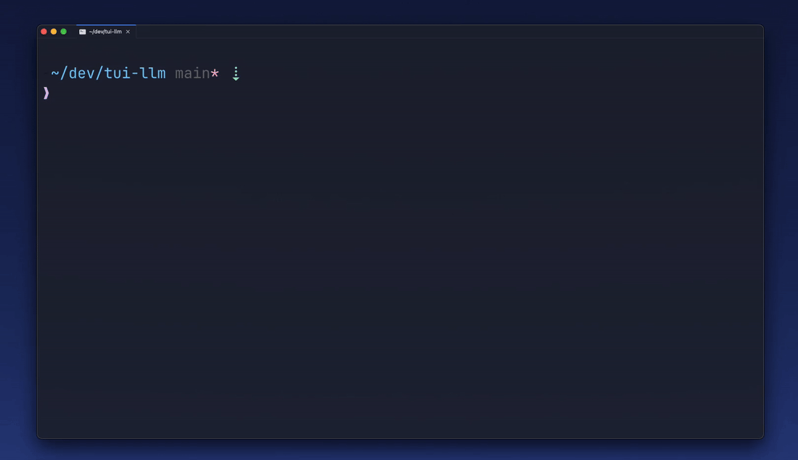

# QueQue — copy-pasting shell commands is dead

[](https://github.com/k-leumas/queque/blob/main/docs/INSTALL.md#zsh)
[](https://github.com/k-leumas/queque/blob/main/docs/INSTALL.md#bash)
[](https://github.com/k-leumas/queque/blob/main/docs/INSTALL.md#set-up-your-shell)

Tests passing on:\
[](https://github.com/k-leumas/queque/actions/workflows/ci.yml)
[](https://github.com/k-leumas/queque/actions/workflows/ci.yml)
[](https://github.com/k-leumas/queque/actions/workflows/ci.yml)
[](https://github.com/k-leumas/queque/actions/workflows/ci.yml)
[](https://github.com/k-leumas/queque/actions/workflows/ci.yml)
[](https://github.com/k-leumas/queque/actions/workflows/ci.yml)
[](https://github.com/k-leumas/queque/blob/main/docs/INSTALL.md)

**Before:** Google it → copy → paste → tweak → pray.

**Now:** Type your intent, hit `??`, pick a command — it lands in your buffer, ready to tweak and run.



## Install

```shell
brew install k-leumas/tap/queque
qq init
source ~/.zshrc    # zsh
source ~/.bashrc   # bash 5 or newer
```

`qq init` detects your shell, wires up the `??` keybinding and adds the QueQue source line to the end of your rc file itself, so nothing needs to be redirected into it.

See [Install](https://github.com/k-leumas/queque/blob/main/docs/INSTALL.md) for installing with npm, the full requirements, the macOS bash notes and how to undo `qq init`.

## Choose a provider

Claude is the default. If you already use Claude Code (signed in with `claude /login`) or have an Anthropic API key (`ANTHROPIC_API_KEY`), there is nothing to set up. To use OpenAI or a local Ollama model instead (both in beta), run `qq init provider`.

See [Choose a provider](https://github.com/k-leumas/queque/blob/main/docs/PROVIDERS.md) for keys, models and restarting the daemon.

## Usage

Type anything before `??` and QueQue turns it into a shell command:

```shell
list files by size??
find docker containers using port 3000??
git undo last commit but keep changes??
```

A picker opens in your terminal: move with the arrow keys and press `Enter`. The command lands in your buffer exactly as shown, ready to run or edit; QueQue never runs it for you. `Esc` cancels and restores what you typed.

See [Usage](https://github.com/k-leumas/queque/blob/main/docs/USAGE.md) for filtering, destructive-command warnings, installed-tool awareness and Zellij.

## More

- [Install](https://github.com/k-leumas/queque/blob/main/docs/INSTALL.md): requirements, Homebrew and npm, zsh and bash, undoing `qq init`.
- [Choose a provider](https://github.com/k-leumas/queque/blob/main/docs/PROVIDERS.md): Claude Code login, API keys, OpenAI and Ollama (beta), restarting the daemon.
- [Usage](https://github.com/k-leumas/queque/blob/main/docs/USAGE.md): the picker, installed-tool awareness, Zellij.
- [Privacy](https://github.com/k-leumas/queque/blob/main/docs/PRIVACY.md): what leaves your machine, debug logging, opt-in anonymous telemetry.
- [Configuration](https://github.com/k-leumas/queque/blob/main/docs/CONFIGURATION.md): the `config.json` fields.
- [System design](https://github.com/k-leumas/queque/blob/main/docs/SYSTEM_DESIGN.md) and [Extensions](https://github.com/k-leumas/queque/blob/main/docs/EXTENSIONS.md): architecture and extension seams.
- [Contributing](https://github.com/k-leumas/queque/blob/main/CONTRIBUTING.md): development setup and developer-only settings.
