<p align="center">
  
</p>

<h3 align="center">Type what you want. Hit <code>??</code>. Pick a command.</h3>
<p align="center">Nothing runs until you press Enter.</p>

<p align="center">
  <a href="https://www.npmjs.com/package/@k-leumas/queque-cli"></a>
  <a href="https://github.com/k-leumas/queque/actions/workflows/ci.yml"></a>
</p>

[](https://github.com/k-leumas/queque/blob/main/docs/INSTALL.md#zsh)
[](https://github.com/k-leumas/queque/blob/main/docs/INSTALL.md#bash)

You're halfway through a command and realize you don't remember the rest. Don't open a browser. Keep typing what you mean, add `??`, and pick the command you were looking for. It lands right back in your buffer, ready to read, edit or run.

**QueQue** *(kew-kew)* is short for *question question*: the `??` you type to call it, and the `qq` you run to set it up.

<p align="center">
  
</p>

## You type → you get

| You type | You get, for example |
| --- | --- |
| `git stash only the staged stuff??` | `git stash push --staged` |
| `docker logs follow the api container??` | `docker logs -f api` |
| `find the 10 biggest files here??` | `du -ah . \| sort -rh \| head -10` |
| `what's listening on port 8080??` | `lsof -i :8080` |
| `convert demo.mov to mp4??` | `ffmpeg -i demo.mov -c:v libx264 -c:a aac demo.mp4` |
| `print every name in users.json??` | `jq -r '.[].name' users.json` |

You get a few options to choose from, each with a one-line explanation. Exact suggestions vary by model.

## Why QueQue

- **It fits the moment you get stuck.** No REPL, no chat window, no new command to remember. Whatever you already typed becomes the question; adding `??` is the whole interface.
- **You choose from several commands.** Each one comes with a plain-English explanation, and you can type to filter the list.
- **It never runs anything.** The command lands in your buffer with a `# what it does` comment. If it needs a value, the cursor waits on the placeholder.
- **It flags destructive commands.** Anything that looks like `rm`, `sudo` and similar is marked `⚠ review carefully`.
- **It knows your tools.** It prefers what you have installed (`rg`, `fd`, `jq`…) and marks suggestions that need a tool you don't have, with the install command one `Tab` away.
- **No key if you already use Claude Code.** It uses your `claude` login. OpenAI and local Ollama are in beta.

<p align="center">
  
</p>

If you used the `??` from GitHub's old Copilot CLI, your fingers already know this one. QueQue works with whichever model you pick and stays out of the way until you call it.

## Install

```shell
brew install k-leumas/tap/queque
qq init
source ~/.zshrc    # zsh
source ~/.bashrc   # bash 5 or newer
```

`qq init` detects your shell, wires up the `??` keybinding and adds the QueQue source line to your rc file. See [Install](https://github.com/k-leumas/queque/blob/main/docs/INSTALL.md) for npm, full requirements, macOS bash notes and how to undo `qq init`.

Tested in [CI](https://github.com/k-leumas/queque/actions/workflows/ci.yml) on Ubuntu 22.04 and 24.04, Debian 13, Fedora 44, Arch Linux and Alpine 3.24; macOS (by hand). Fish support is on the way.

## Choose a provider

Claude is the default. If you're signed in to Claude Code (`claude /login`) or have `ANTHROPIC_API_KEY` set, there is nothing to set up. To use OpenAI or a local Ollama model instead (both in beta), run `qq init provider`. See [Choose a provider](https://github.com/k-leumas/queque/blob/main/docs/PROVIDERS.md).

**Privacy:** QueQue sends your request and a little context (such as your working directory, shell and git status) to the one provider you chose, never file contents. Telemetry is off unless you opt in. With a local Ollama, nothing leaves your machine. Details in [Privacy](https://github.com/k-leumas/queque/blob/main/docs/PRIVACY.md).

## More

- [Usage](https://github.com/k-leumas/queque/blob/main/docs/USAGE.md): the picker, filtering, destructive-command warnings, installed-tool awareness, Zellij floating panes.
- [Install](https://github.com/k-leumas/queque/blob/main/docs/INSTALL.md): requirements, Homebrew and npm, zsh and bash, undoing `qq init`.
- [Choose a provider](https://github.com/k-leumas/queque/blob/main/docs/PROVIDERS.md): Claude Code login, API keys, OpenAI and Ollama (beta), restarting the daemon.
- [Privacy](https://github.com/k-leumas/queque/blob/main/docs/PRIVACY.md): what leaves your machine, debug logging, telemetry, and the daily [update check](https://github.com/k-leumas/queque/blob/main/docs/PRIVACY.md#update-check) (`QQ_NO_UPDATE_CHECK=1` turns it off).
- [Configuration](https://github.com/k-leumas/queque/blob/main/docs/CONFIGURATION.md): the `config.json` fields.
- [System design](https://github.com/k-leumas/queque/blob/main/docs/SYSTEM_DESIGN.md) and [Extensions](https://github.com/k-leumas/queque/blob/main/docs/EXTENSIONS.md): architecture and extension seams.
- [Contributing](https://github.com/k-leumas/queque/blob/main/CONTRIBUTING.md): development setup and developer-only settings.
