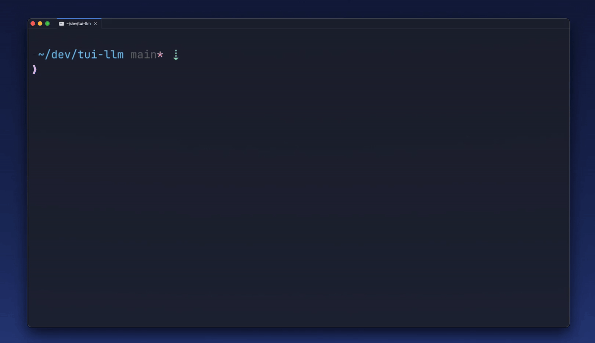

# QueQue — copy-pasting shell commands is dead

**Before:** Google it → copy → paste → tweak → pray.

**Now:** Type your intent, hit `??`, pick a command — it lands in your buffer, ready to tweak and run.


#### Copy-pasting commands from the browser is dead.

Welcome to the **future** –
`
 brew install k-leumas/tap/queque
`




> [!NOTE]
> After install, run `qq init zsh && source ~/.zshrc` to wire up the `??` keybinding. `qq init zsh` adds the QueQue source line to the end of `~/.zshrc` itself, so do not redirect its output into the file.


<details>
<summary>Install via npm</summary>

## Requirements

- zsh
- Node.js 24 or newer
- [jq](https://jqlang.github.io/jq/)
- Claude Code signed in, an Anthropic API key, an OpenAI API key, or Ollama (see [Choose a provider](#choose-a-provider))


```shell
npm install -g @k-leumas/queque-cli
qq init zsh && source ~/.zshrc
```

</details>

## Choose a provider

Claude is the default. If you already use Claude Code or have an Anthropic API key, there is nothing to set up. To use OpenAI or a local Ollama model instead (both in beta), run `qq init provider` once.

### Claude (default)

QueQue talks to Claude in one of two ways. You only need one.

**Claude Code login (no API key needed).** If you already use Claude Code, QueQue runs `claude -p` on your existing login whenever no API key is set. Sign in once through Claude Code's `/login`:

```shell
claude /login
```

On this route QueQue uses whatever account and default model Claude Code is set to; it passes no model flag. `claude -p` runs with its tools disabled and session persistence off, so it only answers the query. If `claude` is not signed in, `??` shows this message and puts back what you typed:

```text
QueQue: Claude is not authenticated. Run `claude /login`, or set ANTHROPIC_API_KEY in the environment or ~/.env.local. To use OpenAI or Ollama instead, run `qq init provider`.
```

If `claude` is not on your `PATH` at all, the message starts with `QueQue: No AI provider is ready.` and lists the same three options. Any other `claude -p` failure, such as an overloaded API or a usage limit, shows `QueQue: Claude Code could not answer (claude -p failed).`; run `claude -p "hi"` to see the underlying error.

**Anthropic API key.** QueQue looks for `ANTHROPIC_API_KEY` in this order:

1. **Environment variable**: `export ANTHROPIC_API_KEY="sk-ant-..."` in `~/.zshrc`, above the QueQue source line.
2. **`.env.local` file**: a line `ANTHROPIC_API_KEY=sk-ant-...` in `~/.env.local`. QueQue reads only `~/.env.local` itself: never the directory you run `??` from and never a directory above your home directory, so a `.env.local` inside a project (or in `/tmp`) is not used. The background daemon reads the file once, when it starts.

An empty or whitespace-only value counts as unset.

**Which route wins.** A non-empty `ANTHROPIC_API_KEY` always wins: QueQue calls Claude through the Anthropic SDK and never runs `claude -p`. There is no automatic fallback in either direction. If the API-key request fails, QueQue shows that error instead of trying your Claude Code login, and a failed `claude -p` run never falls back to a key. To switch to your Claude Code login, remove the key from your environment and `~/.env.local`, then restart the daemon.

`QQ_MODEL` (in your environment or `~/.env.local`) picks the model on the API-key route only. The default is `claude-sonnet-5`.

### OpenAI or Ollama (beta)

Run the picker in a terminal:

```shell
qq init provider
```

It asks one question (Claude, OpenAI or Ollama), saves your answer to `~/.config/qq/provider.json`, and restarts the background daemon. Nothing is probed until you answer, and `??` never asks you to choose.

- **OpenAI (beta)** needs `OPENAI_API_KEY` in your environment (`export OPENAI_API_KEY="sk-..."` in `~/.zshrc`, above the QueQue source line) or in `~/.env.local`. Set the key first, open a new terminal, then run `qq init provider`. QueQue never asks for the key and never stores it: `provider.json` only records that you chose OpenAI. The default model is `gpt-5.5`.
- **Ollama (beta)** lists the models you have already pulled and pins the one you pick. If Ollama is not running, the picker prints the download link and `ollama serve`. If it has no models, the picker tells you to run `ollama pull`. When `provider.json` has a `baseUrl` (a remote server), the picker lists and keeps that server; to go back to Ollama on this machine, remove `baseUrl` from `provider.json`.

Your choice sticks. If the chosen provider fails, `??` shows that provider's error; QueQue never switches to a different provider on its own. Run `qq init provider` again to switch, including back to Claude.

Every provider gets 25 seconds per `??`. If an OpenAI or Ollama answer is cut off before a full command, QueQue asks the same provider once more within those same 25 seconds. If the second try also falls short, you get the commands that did arrive, or a "cut off" message when none did. When an OpenAI model rejects one of QueQue's request settings, QueQue re-sends without it and remembers that for the model until the daemon restarts.

`provider.json` is plain JSON you can edit by hand, and QueQue reads it again on every `??`:

```json
{"version":1,"provider":"ollama","model":"gemma4"}
```

Add `"model"` to an OpenAI pin to change the model, or `"baseUrl"` to an Ollama pin to use a server other than `http://localhost:11434`. Keys are not allowed in this file: an extra field such as `"apiKey"` makes it invalid, and `??` then tells you to fix the file or run `qq init provider`. Set `QQ_PROVIDER_FILE` to an absolute path to keep the file somewhere else; a relative path makes the pin invalid.

### After changing your key or settings

A background daemon answers `??` for every terminal. It starts with your first interactive shell (and again on the next `??` if it is not running) and inherits that shell's environment. It reads `ANTHROPIC_API_KEY`, `OPENAI_API_KEY`, `QQ_MODEL`, `~/.env.local` and `~/.config/qq/config.json` once, when it starts. `provider.json` is the exception: it is read on every `??`. On the Claude Code login route, the daemon also keeps one idle `claude -p` process ready, so the next `??` skips Claude Code's start-up.

- `qq init provider` restarts the daemon for you, so running it after exporting a new key is enough.

- Put your `export` lines in `~/.zshrc` above the `# queque shell integration` block that `qq init zsh` appended, so the daemon started during shell startup sees them.
- After changing any of them, restart the daemon from a shell that has the new values:

```shell
pkill -f 'daemon --socket /tmp/qq-'
qq daemon --ensure
```

## Usage

Type anything before `??` and QueQue turns it into a shell command:

```shell
list files by size??
find docker containers using port 3000??
git undo last commit but keep changes??
```

A selection UI opens in-terminal. Rows appear as the provider answers. Only Claude streams them today, so with Claude you can pick one before the rest have arrived; OpenAI and Ollama show the whole list at once. What you typed stays in the dim `queque ›` header, and the FILTER box opens empty: type to narrow the list, even while `thinking…` is still showing. Move with the arrow keys and press `Enter`. The command lands in your buffer exactly as shown, ready to run or edit. QueQue never runs it for you.

Press `Esc` to cancel. It stops the request to the provider and restores what you were typing, so you can tweak your intent and hit `??` again.

A command that matches a destructive pattern (`rm`, `sudo` and similar) is marked `⚠ review carefully — this command may be destructive`. The mark is a warning only; the row stays selectable.

### Installed-tool awareness

On every `??`, zsh refreshes its list of the commands it can find (`rehash`), so a tool you installed a moment ago in the same shell counts. QueQue uses that list in two ways.

**It tells the provider which well-known tools you have.** QueQue ships a fixed catalog of 196 public command-line tool names that have common alternatives, such as `rg`, `fd`, `bat`, `jq` and `kubectl`. The request includes only the catalog tools you have installed, with instructions to prefer them, to make at least one suggestion that uses only installed tools, and never to suggest install steps. The catalog mostly leaves out basic utilities such as `ls`, `grep` and `find`; the provider is told those are present. Nothing outside the catalog is sent: the rest of your `PATH`, your shell functions and your aliases stay on your machine. The catalog is checked twice, once before the request leaves the client and again just before the prompt is built, so a name that is not in it never reaches a provider.

**It marks suggestions that need a missing tool.** This check runs locally, against the full list. A row that needs a tool zsh cannot find gets `ⓘ` before its explanation, and the legend reads `ⓘ not installed`. The row stays selectable. When QueQue knows how to install that tool with brew, apt, dnf or pacman, the legend adds `tab prepends the install command`: press `Tab` (or `Shift+Tab`) on the row to switch it to the install form, and again to switch back. The install form is inserted like any other command, never run.

Set `QQ_TOOL_AWARENESS=0` in your shell to turn off both: no tool names are sent and no rows are marked.

### Inside Zellij

QueQue detects Zellij automatically and opens in a floating pane instead of inline. Same trigger, same result, better layout.

Set `QQ_PANE_WIDTH` (default `80`) and `QQ_PANE_HEIGHT` (default `24`) to resize the floating pane.

Without Zellij, QueQue falls back to an inline TUI in your current terminal session.

## Privacy defaults

QueQue is **insertion-only**: it writes commands into your shell buffer — you press Enter to run them. QueQue never auto-executes suggestions.

**What leaves your machine (Claude and OpenAI, hosted).** The provider you chose receives the same context, whichever it is: Claude (through `claude -p` or the API key) or OpenAI (through `OPENAI_API_KEY`). Only that one provider receives it:

- Your query text and current working directory
- Your OS platform name (for example `darwin` or `linux`) and shell name (`zsh`)
- Git metadata (repository root path, branch, dirty flag, changed file *names* — not file contents)
- Parsed filename hints from your query (no disk reads)
- The names of installed tools that appear in QueQue's public catalog of 196 well-known tools (see [Installed-tool awareness](#installed-tool-awareness)). The rest of your `PATH`, your function names and your alias names stay on your machine. `QQ_TOOL_AWARENESS=0` stops even the catalog names.

**With Ollama**, the same context goes only to your Ollama server (`http://localhost:11434` by default, or the `baseUrl` in `provider.json`). With the default setting, nothing leaves your machine. A `baseUrl` that starts with `http://` and names another machine sends that context across the network unencrypted; for a remote server, use an `https://` URL (for example behind a reverse proxy).

**What QueQue never sends:**

- File contents. `QQ_ALLOW_FILE_READ=1` is reserved for a future opt-in and reads nothing today.
- Paths matching sensitive patterns (`.env`, credentials, `.pem`, `id_rsa`, `.ssh/`, `.aws/`, `secret`) are stripped from git context

**Debug logging:** The client and daemon append short diagnostics to `/tmp/qq-<uid>-debug.log`, or to the file named by `QQ_DEBUG_LOG_FILE`. Shell buffer and query text are redacted unless `QQ_DEBUG_VERBOSE=1`. The zsh widget adds its own lines only when `QQ_DEBUG_LOG_FILE` is set. The log stays on your machine.

**User config:** Copy [docs/config.example.json](docs/config.example.json) to `~/.config/qq/config.json` to add extra sensitive path patterns, log redaction keys, or destructive-command warnings. Built-in defaults always apply — your patterns are merged on top. Override the file path with `QQ_CONFIG_FILE`: a leading `~/` means your home directory, and a relative path is resolved against your home directory. Malformed `config.json` is ignored with a warning; QueQue falls back to built-in defaults (fail-closed).

See [docs/EXTENSIONS.md](docs/EXTENSIONS.md) for the expansion path (local learning, multi-provider, plugins).

## Configuration reference

Copy [docs/config.example.json](docs/config.example.json) to `~/.config/qq/config.json` (or set `QQ_CONFIG_FILE`). Field meanings:

| Field | Type | Purpose |
|-------|------|---------|
| `effort` | `"low" \| "medium" \| "high" \| "xhigh" \| "max"` | Claude effort for `claude -p` (`--effort`) and for the API-key SDK path, which sends it as `output_config.effort`. The SDK path omits it when `QQ_MODEL` names a model without effort support (Haiku 4.5, Sonnet 4.5 or older); a level that a `QQ_MODEL` model does not support (for example `xhigh` on Opus 4.5) is your responsibility. Default `low`. Trimmed and case-insensitive; invalid values fall back to `low` without affecting the rest of the file. Takes effect after a [daemon restart](#after-changing-your-key-or-settings), because the daemon reads config.json once. OpenAI and Ollama ignore it. |
| `privacy.sensitivePathPatterns` | `string[]` | Extra regex patterns merged onto built-in defaults (`.env`, credentials, keys, etc.). Built-in patterns are never removed. An invalid pattern, or one longer than 256 characters, is skipped. |
| `privacy.redactLogKeys` | `string[]` | Extra JSON keys to redact in debug logs (merged with defaults: `lbuffer`, `rbuffer`, `queryText`, `request`). |
| `privacy.allowFileRead` | `boolean` | Opt-in gate for future file-content context. Env `QQ_ALLOW_FILE_READ=1` overrides this. No file reads in v1. |
| `privacy.useGitignore` | `boolean` | Reserved for future gitignore-based filtering. Ignored today. |
| `safety.destructiveCommandPatterns` | `string[]` | Extra warn-only UI patterns merged onto built-in defaults (`rm`, `sudo`, `chmod -R`, writes to `/dev/`, `curl` or `wget` piped to `sh`). The same skip rule applies. |

See [docs/SYSTEM_DESIGN.md](docs/SYSTEM_DESIGN.md) for architecture.


